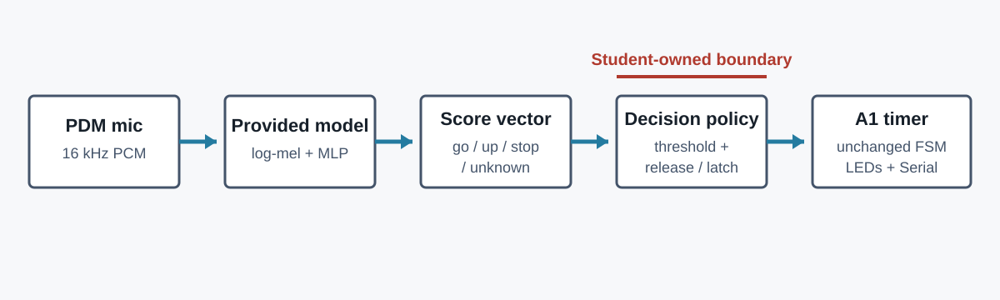

# A2: Voice-controlled timer

**Due:** Friday, October 23 at 4:59 p.m. Pacific Time

**Automatic grace and close:** Canvas accepts submissions through 11:59 p.m. Friday and closes
at 12:00 a.m. Saturday. There is no late-submission period after the grace period.

## Build a voice-controlled timer

In A1, light-sensor gestures produced events for a countdown timer. A2 keeps that timer and replaces
the light interface with three spoken commands:

| Spoken command | Timer action |
|---|---|
| `up` | Enter `ADDING` with 10 seconds or add another 10 seconds |
| `go` | Start `COUNTDOWN` when time is available |
| `stop` | Clear the time and return to `STANDBY` |

The supplied audio classifier does not produce commands. For each one-second audio input, it
produces four scores in this order:

```text
go, up, stop, unknown
```

Together, these four values form a **score vector**, which is the model's complete output for one
input.

Treat those scores as measurements from a model, not as proof that the user intended a command. A
score can be wrong, uncertain, or repeated across several overlapping audio windows. An **audio
window** is the fixed block of microphone samples used for one inference.

Build the boundary between the model and the timer. Measure the model, choose an acceptance policy,
convert score sequences into command events, and document the resulting system's capabilities and
limitations.


*A2 replaces the A1 light interface. The A1 timer state machine remains unchanged.*

## Assignment structure

### Lab outcome

A **model artifact** is the versioned collection of files needed to reproduce a particular trained
model and use it for inference.

During the Lab, you will:

- Load and inspect a released model artifact.
- Connect a recorded audio window to the model.
- Relate one labeled, one-second recording to one score vector.
- Evaluate a provided 623-example benchmark.
- Collect and evaluate a 40-example local validation set.

Use the Lab to measure the classifier. The Challenge threshold and command-event policy are not
selected or implemented during the Lab.

### Challenge outcome

During the Challenge, you will:

- Select an acceptance threshold from a supplied application requirement.
- Implement a stateful policy that uses scores and elapsed time to produce events.
- Prevent overlapping predictions from producing unintended repeated events.
- Connect accepted commands to the unchanged A1 timer.
- Test the complete voice-controlled system.

## Use each data source for a specific claim

Each A2 data source answers a different question. A **benchmark** is a fixed labeled dataset used
to measure model behavior consistently. The **local validation set** applies the same evaluation
procedure to recordings collected from your own board and environment.

| Data | What one item represents | What it is used for |
|---|---|---|
| Your first Lab trials | One labeled, one-second local recording and one model score vector | Learn what model input, ground truth, and output mean |
| `keyword_eval.csv` | 623 labeled one-second recordings from 236 held-out speakers who were not used for training or validation, with one score vector per recording | Measure benchmark confusion and class behavior |
| Your local validation set | 40 labeled one-second recordings from your board, voice, room, and collection session | Apply the same evaluation process under local conditions |
| `score_traces.csv` | Ordered score vectors from overlapping windows, one result every 250 ms | Test how a stream of predictions becomes command events |
| Final system trials | Spoken attempts made to the completed timer | Test end-to-end event and timer behavior |

The first three sources use independent one-second examples. Sequential traces are different. In
the deployed system, the one-second input window advances every 250 ms, so one utterance can affect
several adjacent predictions.

Keep each claim tied to its source. Use the 623-example benchmark to describe only the recordings
from its held-out speakers, the 40-example local set to describe one local collection session, and
the final system trials to describe the complete timer under the conditions you report.

## Supplied files and your work

You are given the A1 timer, microphone service, integration sketches, benchmark data, sequential
traces, and notebook structure. The trained classifier is published as a separate versioned
release.

| Supplied component | Your work |
|---|---|
| Released model artifact | Obtain it, inspect it, and place its source in each Arduino sketch |
| `Lab_2_1.ino` | Connect recorded audio to the model with the two indicated function calls, then collect trials |
| `Lab_2_2_Evaluation.ipynb` | Complete the benchmark calculations and evaluate your local set |
| `Challenge_2_Policy.ipynb` | Select the acceptance threshold and precision-recall tradeoff, inspect traces, and design two policy tests |
| `command_policy.cpp` | Implement event suppression and reset timing using the supplied code |
| `check_command_policy.py` | Run visible, named C++ policy checks before hardware integration |
| A1 timer and `Challenge_2.ino` | Use them without changing their interface or behavior |

Do not edit released model source, supplied headers, `a1_timer_logic.*`, or the integration
sketches. Edit only the files named in the Lab and Challenge problems.

## Submit one complete ZIP

Submit one complete ZIP to the A2 assignment in Canvas. Include the Lab and Challenge notebooks,
both Arduino projects with the required model files, and the documentation and evidence named in
the **Final Canvas ZIP checklist**. Staff grade the code and notebooks from that ZIP.

You may replace the ZIP before Canvas closes at 12:00 a.m. Saturday. Staff use the latest eligible
submission unless you have an approved individual extension. Download your submitted ZIP and
confirm that it opens and contains the intended files.

## Lab: Measure the classifier

**Planned session:** Thursday, October 15, three hours

Finish Problems L1-L8 during the scheduled Lab. L1-L4 bring the model onto the board and establish
the meaning of one labeled example. L5-L7 evaluate the larger provided benchmark. L8 repeats the
same evaluation structure on your local 40-example set.

### Equipment and wiring

- Seeed Studio XIAO ESP32-S3 Sense and a USB-C data cable.
- Three distinct-color LEDs with one 220 to 330 Ω resistor per LED.
- Pushbutton from GPIO5 to GND using `INPUT_PULLUP`.
- Breadboard and jumper wires.

Keep the A1 LEDs on GPIO2, GPIO3, and GPIO4. The Lab uses GPIO2 to mark the one-second recording
interval. The onboard pulse-density modulation (PDM) microphone uses GPIO41 for data and GPIO42
for clock. The LDR may remain connected, but A2 does not read it.

### Collect one Lab trial

The Lab sketch cycles through `go`, `up`, `stop`, and `unknown` as the expected labels.

1. In Serial Monitor, read the expected label for the next trial.
2. Press GPIO5, release the button, and prepare to speak during the short delay.
3. While GPIO2 is on, say the expected target word once. For `unknown`, say a non-command word
   instead of the word "unknown."
4. After GPIO2 turns off, read the model's `TRIAL_RESULT` row in Serial Monitor.

One `TRIAL_RESULT` row contains the trial ID, true label, recording duration, root-mean-square
(RMS) audio level, four model scores, argmax result (the label with the largest score), and
processing time. This is the same basic information represented by one row of the provided
benchmark.

---

### L1: Obtain and inspect the model release

**Goal:** Identify the model artifact and its interface before compiling the code.

**Procedure**

1. Open the public [`ece116-tinyml-models`](https://github.com/ejaywang/ece116-tinyml-models)
   repository.
2. Use the fixed [`keyword-commands-v1.0.0`](https://github.com/ejaywang/ece116-tinyml-models/releases/tag/keyword-commands-v1.0.0)
   release. Do not substitute a later version.
3. Read the [model card](https://github.com/ejaywang/ece116-tinyml-models/blob/keyword-commands-v1.0.0/models/keyword-commands/MODEL_CARD.md).
4. Download and extract `ece116-keyword-arduino-v1.0.0.zip` outside the A2 package.
5. Inspect these files:

| File | What to identify |
|---|---|
| `MODEL_CARD.md` | Intended task, input, output labels, data source, measured behavior, and limitations |
| `artifact.json` | JSON record of the artifact version and files included in the release |
| `model_metadata.h` | Input dimensions, sample rate, label count, and model dimensions |
| `model_params.h` | Learned weights and biases |
| `ece116_audio.*` | Microphone capture and audio-window interface |
| `ece116_keyword.*` | Sketch-facing model interface and inference implementation |

**Evidence:** Under **Model artifact** in `Documentation/README.md`, record the repository URL,
artifact ID, release tag, model or library version, sample rate, input duration, and label order.
Describe the roles of the metadata, parameter, interface, and implementation files.

**Complete when:** Identify the file that contains the learned parameters and the file that defines
the required input shape. Do not edit or copy the model source yet.

---

### L2: Add the model source to the Lab sketch

**Goal:** Make the released model part of one reproducible Arduino build.

**Procedure**

1. Open `Arduino/Lab_2_1/`.
2. Create `src/ECE116_A2_Keyword/` inside that sketch.
3. Copy the six files from the extracted release's `arduino/ECE116_A2_Keyword/src/` folder into the
   new sketch-local folder.
4. Confirm this structure:

```text
Lab_2_1/
|-- Lab_2_1.ino
`-- src/
    `-- ECE116_A2_Keyword/
        |-- ece116_audio.cpp
        |-- ece116_audio.h
        |-- ece116_keyword.cpp
        |-- ece116_keyword.h
        |-- model_metadata.h
        `-- model_params.h
```

Do not install the model as a global Arduino library. Arduino compiles source recursively under a
sketch's local `src/` folder, so the dependency stays with this build.

Use Espressif `esp32` core 3.3.10 and board target `XIAO_ESP32S3`. In Arduino IDE, select
**Tools > PSRAM > OPI PSRAM**. The model input and overlapping microphone buffers require the
XIAO's external pseudo-static RAM (PSRAM). OPI is the octal interface used to access that memory.

If the board port is missing or an upload cannot connect, recover the board:

1. Close Serial Monitor.
2. Hold `BOOT`.
3. Tap and release `RESET`.
4. Release `BOOT`.
5. Select the new USB modem port, and upload the sketch again.
6. If the uploaded sketch does not start, tap `RESET`.

**Evidence:** Under **Build and reproduction** in the README, record the download location, copied
source folder, Arduino board, core version, and PSRAM setting.

**Complete when:** You should be able to compile the Lab sketch without a missing-header error.
Until L3 is complete, a model input error should still be reported by the starter.

---

### L3: Connect one recorded window to the model

**Goal:** Connect captured audio to the model input and receive one score vector.

**Procedure**

Open `Arduino/Lab_2_1/Lab_2_1.ino` and complete both TODOs:

1. **TODO L3a:** Replace the placeholder with
   `pcm16_signal_from_buffer(trialAudioWindow, EI_CLASSIFIER_RAW_SAMPLE_COUNT, &signal)`.
   This presents the recorded digital audio samples to the model in the format it expects.
2. **TODO L3b:** Replace the placeholder with `run_classifier(&signal, &result, false)`.
   This runs inference and fills the result structure.

Compile and upload after each TODO. Open Serial Monitor at 115200 baud.

**Evidence:** Under **Model artifact** in the README, explain the different jobs performed by `pcm16_signal_from_buffer()` and `run_classifier()`.

**Complete when:** Serial Monitor should print `MODEL_READY` followed by `NEXT_TRIAL`. After you
press GPIO5, one `TRIAL_RESULT` should appear instead of `MODEL_INPUT_ERROR` or
`INFERENCE_ERROR`.

---

### L4: Learn the unit of classifier evaluation

**Goal:** Relate one labeled, one-second recording to one model prediction.

**Procedure**

Collect the first four trials. Follow the expected label printed by Serial:

1. Say `go` during trial 1.
2. Say `up` during trial 2.
3. Say `stop` during trial 3.
4. Say one non-command word during trial 4.

For each trial, speak once while GPIO2 is on. Do not repeat the word after the recording interval.

Read each `TRIAL_RESULT` as one labeled example:

- `true_label` records what the example was intended to contain;
- `go`, `up`, `stop`, and `unknown` are the model scores;
- `argmax_label` is the class with the largest score;
- a mismatch between `true_label` and `argmax_label` is one classification error.

**Evidence:** Under **Understanding one example** in the README, copy one complete `TRIAL_RESULT`.
Identify its true label, complete score vector, argmax label, and whether the argmax is correct.
Explain why the true label and model output are separate pieces of information.

**Complete when:** Explain what one row represents by using its recorded true label and scores,
not your memory of the spoken word.

---

### Notebook setup for L5-L8

Google Colab is the supported environment for the A2 notebooks. The notebooks use Python, NumPy,
and Matplotlib. Keep the complete A2 package structure because each notebook reads data from
`Python/` and writes evidence to the sibling `Documentation/` folder.

1. In Colab, choose **File > Upload notebook** and select
   `Python/Lab_2_2_Evaluation.ipynb` from the extracted starter package.
2. Run the notebook's **Notebook environment** cell.
3. When prompted, upload the complete A2 starter ZIP. Do not upload only the notebook or CSV files.
4. Confirm that the setup reports `Google Colab`, a working directory ending in `Python`, and
   `companion files: PASS`.
5. Complete and run the notebook in order. Save its outputs.
6. Choose **File > Download > Download .ipynb**. Replace the unfinished notebook in your local A2
   package with the executed download.
7. In Colab's Files panel, download the generated figures from
   `/content/ECE116_A2/Documentation/Fig/` into the matching local folder.

Repeat the same process for `Python/Challenge_2_Policy.ipynb`. Local Jupyter remains usable when
the notebook starts from the package's `Python/` directory, but Colab is the supported course
path.

Official setup references:

| Environment | Reference |
|---|---|
| Browser-based notebook | [Welcome to Google Colab](https://colab.research.google.com/notebooks/welcome.ipynb) |
| Colab files and runtimes | [Google Colab FAQ](https://research.google.com/colaboratory/faq.html) |
| Local Jupyter | [Installing Jupyter](https://jupyter.org/install) |

Run the first cell in `Lab_2_2_Evaluation.ipynb`. It must report:

```text
truth shape: (623,)
scores shape: (623, 4)
label order: ['go', 'up', 'stop', 'unknown']
```

If it fails, correct the working directory or missing files before editing notebook code. Run the
notebook from the beginning after each change and save the outputs.

---

### L5: Understand and validate the provided benchmark

**Goal:** Apply the one-example evaluation process across `keyword_eval.csv`.

The file contains 623 labeled one-second recordings from 236 speakers who do not appear in model
training or validation. Each row stores a true label and the released model's four scores for that
recording. It is provided because a four-trial demonstration cannot estimate classifier behavior.

One recording, one clip identity, and one speaker identity answer different questions. A speaker
can contribute several recordings, so counting rows does not count speakers. Inspect the loaded
objects before calculating anything:

```python
print(truth.shape)
print(scores.shape)
print(metadata.keys())
print(metadata['speaker_id'][:5])
```

`set()` removes duplicates before `len()` counts them:

```python
example_speakers = ['speaker_a', 'speaker_a', 'speaker_b']
len(example_speakers)       # 3 recordings
len(set(example_speakers))  # 2 speakers
```

**Procedure**

Complete notebook TODOs `L5a` through `L5f`:

- count examples, unique clip IDs, and unique speakers;
- verify that every score is between 0 and 1;
- find the smallest and largest sum across the four scores in each row.

Use these directly transferable expressions:

```python
len(truth)
len(set(metadata['clip_id']))
len(set(metadata['speaker_id']))
bool(np.all((scores >= 0.0) & (scores <= 1.0)))
float(score_vector_sums.min())
float(score_vector_sums.max())
```

The supplied expression `scores.sum(axis=1)` produces one score sum per recording. Match each
integrity question to the corresponding expression. The learning goal is to explain what each
check protects against, not to recall NumPy syntax from memory.

**Evidence:** Keep the integrity output in the executed notebook. Under **Provided benchmark** in
the README, define one row and report the number of examples and speakers.

**Complete when:** The executed notebook should report 623 unique clips from 236 speakers, scores
inside `[0, 1]`, and per-row score sums near 1.

---

### L6: Build and read the confusion matrix

**Goal:** Replace hundreds of individual predictions with a count of which classes are confused.

**Procedure**

Complete notebook TODOs `L6a` through `L6c`:

- calculate one argmax class index for every score vector;
- increment the matrix cell at each `(true class, predicted class)` pair;
- calculate overall argmax accuracy from the matrix diagonal.

Rows are true labels. Columns are predicted labels. Read a cell as a sentence before interpreting
it, such as "a true `go` recording was predicted as `unknown`".

For this three-example toy set:

```text
true label:      go   up   go
predicted label: go   go   unknown
```

increment `(go, go)`, `(up, go)`, and `(go, unknown)` once each. Apply the same operation to every
benchmark row with:

```python
predicted_class_indices = np.argmax(scores, axis=1)
matrix[true_class_index, predicted_class_index] += 1
accuracy = np.trace(matrix) / matrix.sum()
```

`axis=1` selects one largest class score within each recording. Incrementing the matrix this way
keeps rows as true labels and columns as predicted labels.

**Evidence:** Keep `Documentation/Fig/a2_confusion.png`. Under **Provided benchmark** in the README,
identify one measured confusion by its true class, predicted class, and count.

**Complete when:** The completed matrix should contain 623 total examples, and both axes should be
labeled.

---

### L7: Measure class-specific behavior

**Goal:** Describe errors that overall accuracy hides.

**Procedure**

Complete notebook TODOs `L7a` through `L7h`. For each selected class, calculate:

| Quantity | Matrix region |
|---|---|
| True positive | Selected class's diagonal cell |
| False positive | Selected prediction column, excluding the diagonal |
| False negative | Selected true-label row, excluding the diagonal |
| True negative | Every cell outside the selected row and column |

Then calculate:

```text
precision   = TP / (TP + FP)
recall      = TP / (TP + FN)
specificity = TN / (TN + FP)
F1          = 2 * precision * recall / (precision + recall)
```

The corresponding matrix expressions are:

```python
true_positive = int(matrix[class_index, class_index])
false_positive = int(matrix[:, class_index].sum() - true_positive)
false_negative = int(matrix[class_index, :].sum() - true_positive)
true_negative = int(
    matrix.sum() - true_positive - false_positive - false_negative
)
```

The selected prediction column contains every example predicted as the class, so removing the
diagonal leaves false positives. The selected true-label row contains every real example of the
class, so removing the diagonal leaves false negatives. Use the supplied `divide_or_zero()` helper
with the formulas shown here. Your responsibility is to interpret what these values mean for the
timer.

Complete the notebook response using one measured confusion. Explain its timer consequence. A false
accepted `stop` can clear the timer, while a missed command usually asks the user to repeat.

**Evidence:** Keep the metric table and written response in the executed notebook. Under
**Provided benchmark** in the README, summarize the most important application consequence.

**Complete when:** Metrics should be present for all four classes, and your response should name a
measured matrix cell and count.

---

### L8: Collect and evaluate a local validation set

**Goal:** Apply the benchmark procedure to one local data-collection session.

**Procedure**

1. Reset the board so the next trial ID is 1. Clear the Serial Monitor output.
2. Record the speaker, approximate mouth-to-board distance, and room condition.
3. Collect 40 trials in one session. The sketch interleaves the expected labels, so completing
   trials 1 through 40 produces 10 examples of each class.
4. For each `unknown` trial, say a non-command word. Use at least five distinct non-command words
   across the 10 trials.
5. Keep every valid result, including misclassifications. A valid failed trial is a complete
   `TRIAL_RESULT` whose `argmax_label` differs from its `true_label`. Record malformed or aborted
   attempts separately, then recollect them so the saved set still contains 40 valid rows.
6. Copy the complete Serial output to
   `Documentation/a2_local_trials.txt`.
7. In Colab's Files panel, upload `a2_local_trials.txt` into
   `/content/ECE116_A2/Documentation/`, replacing an older copy if present.
8. Run the L8 section of `Lab_2_2_Evaluation.ipynb`. It loads the 40 `TRIAL_RESULT` rows, verifies
   the class counts, builds a local confusion matrix, and saves
   `Documentation/Fig/a2_local_confusion.png`.
9. Replace the local-validation response in the notebook.

**Evidence:** Under **Local model validation** in the README, report the collection conditions,
class counts, local matrix, failed trials, and non-command words. Compare one local pattern with
the benchmark. Do not present 40 local trials as general model accuracy.

**Complete when:** The executed notebook should report 40 rows and 10 examples per class, include
the saved local figure, and run from beginning to end without an error. Save it in the final
Canvas ZIP.

### Prepare the policy self-check environment

Use the small C++ program that runs on your computer to test `command_policy.cpp` without the
microphone, model weights, LEDs, or timer. This self-check requires `c++`, `g++`, or `clang++` on the command
path. It does not use the ESP32 compiler managed internally by Arduino IDE, and no other A2 task
requires this host compiler.

Verify the environment before starting the Challenge:

1. In the same extracted A2 package, open a terminal in the `Python/` folder.
2. Check for a supported compiler:

   ```bash
   python check_command_policy.py --check-environment
   ```

3. Confirm that the output names a compiler and distinguishes it from the Arduino IDE compiler.
4. If the output reports `NOT FOUND`, upload and extract the complete A2 package in Google Colab.
   In a Colab code cell, run:

   ```python
   !python check_command_policy.py --check-environment
   ```

Only the environment is checked in this step. The Challenge policy tests are not run, and no
policy implementation is revealed.

**Completion check:** A path to `c++`, `g++`, or `clang++` should be reported. Record whether you
used the local environment or Colab under **Build and reproduction** in the README.

## Challenge: Turn scores into timer events

In the Lab, you evaluated independent one-second examples. The deployed system is a stream. A new
one-second model input becomes available every 250 ms, so one spoken word can produce several high
scores. The timer must still receive at most one event for that utterance.

A **temporal policy** is a stateful rule that uses current scores, recent decisions, and elapsed
time. You will implement a Challenge policy with two jobs:

1. Decide whether one score vector contains an acceptable target command.
2. After emitting an event, enter a latched state and suppress adjacent predictions. Return to the
   armed state when the scores have fallen below the release threshold for the required time, or
   when the maximum latch duration is reached.

```text
overlapping audio windows -> score vectors -> accept or reject -> armed/latched policy state
                          -> command event -> A1 event mapping -> unchanged A1 timer
```

### Challenge setup

The Challenge is a separate Arduino sketch. Create
`Arduino/Challenge_2/src/ECE116_A2_Keyword/` and copy the same six model source files from the
extracted v1.0.0 release. Do not use a different model version.

Edit only:

- `Python/Challenge_2_Policy.ipynb`;
- `Arduino/Challenge_2/command_policy.cpp`;
- the Challenge sections of `Documentation/README.md`;
- requested files under `Documentation/Fig/`.

`command_policy.h` defines every function input, state field, unit, threshold direction, and return
value. Do not rename its functions or change their parameters. `Challenge_2.ino` maps accepted A2
commands into the unchanged A1 event interface:

| A2 command | A1 event | Timer behavior |
|---|---|---|
| `COMMAND_EVENT_UP` | `COVER_EVENT_TAP` | Add 10 seconds |
| `COMMAND_EVENT_GO` | `COVER_EVENT_COMMIT` | Start countdown |
| `COMMAND_EVENT_STOP` | `COVER_EVENT_CANCEL` | Clear time and return to standby |
| `COMMAND_EVENT_NONE` | `COVER_EVENT_NONE` | No state change |

---

### C1: Select the acceptance threshold

**Goal:** Choose an operating point from an application requirement instead of guessing a score.

An **operating point** is the selected threshold together with its measured precision and recall.

**Requirement**

Among benchmark windows accepted as `GO`, `UP`, or `STOP`, at least 97% must have the correct target
label. A false accepted command can add time, start the timer, or clear it without user intent.

**Procedure**

In `Challenge_2_Policy.ipynb`:

1. Keep `MINIMUM_PRECISION = 0.97`.
2. Use `ev.lowest_threshold_meeting()` to find the lowest tested threshold satisfying the
   requirement.
3. For `TODO C1a`, set `ACCEPT_THRESHOLD` from `choice`.
4. For `TODO C1b`, report the selected threshold, precision, and recall. Explain why the lowest
   qualifying point is used instead of a higher tested threshold.

**Evidence:** Keep the threshold sweep and `Documentation/Fig/a2_threshold_sweep.png`. Under
**Operating policy** in the README, summarize the requirement, selected point, and tradeoff.

**Complete when:** The executed notebook should report `ACCEPT_THRESHOLD: 0.90`, and your response
should explain the recall cost of rejection.

---

### C2: Trace and design temporal-policy tests

**Goal:** Predict policy behavior from visible score sequences and construct evidence for both
ways of returning to the armed state.

**Required state transitions**

Use the acceptance threshold selected in C1 with these supplied timing values:

- Release threshold: `0.55`
- Minimum latch time: `1000 ms`
- Maximum latch time: `1500 ms`

| State | Condition | New state | Event |
|---|---|---|---|
| Armed | Top target score is at least the accept threshold | Latched | Matching command |
| Armed | Otherwise | Armed | `NONE` |
| Latched | Minimum time elapsed and every target score is below release | Armed | `NONE` |
| Latched | Maximum latch time elapsed | Armed | `NONE` |
| Latched | Otherwise | Latched | `NONE` |

`Armed` means that a new command can be accepted. `Latched` means that a command event has already
been emitted and adjacent predictions are being suppressed. To **rearm** the policy is to return
from `Latched` to `Armed`.

Normal release is:

```text
minimum latch time has elapsed
AND every GO, UP, and STOP score is below the release threshold
```

The window that rearms the policy must not emit an event. Normal release is the primary way to
decide that the previous utterance has ended. The maximum latch duration is a fail-safe: it returns
the policy to `Armed` after `1500 ms` even if the target scores remain high.

**Procedure**

1. Before running the trace cell, predict every state and event for
   `class_shift_one_utterance` and `maximum_latch_recovery`.
2. Run the trace table. Compare the state before and after each window, the strongest
   class, normal-release flag, timeout flag, event, and reason with your prediction.
3. Complete `student_normal_release` at TODO C2a. Choose at least four windows that accept one
   command, suppress an adjacent window, rearm normally, emit nothing from the release window, and
   accept a later different command.
4. Complete `student_maximum_latch` at TODO C2b. Include windows immediately before and at
   `1500 ms` while a target score remains high, then include a later command.
5. Complete the expected event lists at TODOs C2c and C2d before running the traces.
6. For TODO C2e, explain what each test proves and name one incorrect policy each test would expose.

Use the supplied constructor so test design does not depend on remembering Python container syntax:

```python
ev.make_trace_window(time_ms, go, up, stop, unknown)
```

**Evidence:** Keep both complete trace tables, expected and observed event lists, and the written
test rationale in the executed notebook.

**Complete when:** Both student-authored traces should match their predicted events. Your
explanation should connect specific timestamps and scores to the policy defect being tested.

---

### C3: Implement the stateful command-event policy

**Goal:** Transfer the evaluated operating point and implement the required `Armed` and `Latched`
transitions without rebuilding the supplied model interface.

You are given the complete argmax helper, class-to-event mapping, target-class check, threshold
comparison, and loop that inspects all three target scores. This supplied code is not part of what
you must implement for the Challenge.

**Procedure**

Complete TODOs `C3a` through `C3f` in `command_policy.cpp`:

- **C3a:** Replace the reject-all accept threshold with `ACCEPT_THRESHOLD` from the notebook.
- **C3b:** Test whether elapsed time is at least `minimumLatchMs`.
- **C3c:** Test whether elapsed time is at least `maximumLatchMs`.
- **C3d:** Combine the all-targets-released condition with the minimum latch condition.
- **C3e:** Mark the policy latched when a command is accepted.
- **C3f:** Record `nowMs` as the latch timestamp.

Use these directly transferable expressions:

```cpp
commandHasBeenLatchedForMs >= config.minimumLatchMs
commandHasBeenLatchedForMs >= config.maximumLatchMs
everyTargetCommandScoreIsBelowReleaseThreshold && minimumLatchTimeHasElapsed
state->commandIsLatched = true;
state->commandLatchedMs = nowMs;
```

The supplied `if (normalReleaseIsReady || maximumLatchTimeHasElapsed)` performs the specified
transition back to `Armed`. The surrounding `Latched` branch returns `COMMAND_EVENT_NONE`, so the
window that rearms the policy cannot emit a command.

**Evidence:** Record the accept and release thresholds and the minimum and maximum latch durations
under **Operating policy** in the README. Explain how the implemented Boolean conditions match the
transition table.

**Complete when:** The notebook and source values should match, and the implementation should
produce the predicted results for the supplied and student-authored traces.

---

### C4: Run the C++ policy self-check

**Goal:** Diagnose policy behavior before adding microphone and timer integration.

Use the policy-check environment that you verified during the Lab. From the package's `Python/`
folder, test the completed policy:

```bash
python check_command_policy.py
```

The script compiles `command_policy.cpp` with a small replacement model interface containing only
the declarations needed for the policy test. It reports named behaviors but does not test the
microphone, model weights, LEDs, or timer. Use a failed behavior name together with the notebook
trace table to identify which transition differs from the required state-transition table.

**Evidence:** Save the complete self-check output. Do not report only the final pass count.

**Complete when:** All public policy behaviors should pass, and you should be able to explain how
the two rearm checks correspond to rows in your own traces.

---

### C5: Test the complete voice-controlled timer

**Goal:** Show that the evaluated policy produces correct events when connected to the inherited timer.

**Procedure**

Compile and upload `Challenge_2.ino` with OPI PSRAM enabled. Run this sequence:

1. Boot to `STANDBY` with zero seconds.
2. Say `up` twice as separate utterances. Confirm `ADDING` with 20 seconds.
3. Say `go`. Confirm `COUNTDOWN` and decreasing whole seconds.
4. Speak a sentence that contains none of the three command words. Confirm no event or timer
   transition.
5. Say `stop`. Confirm `STANDBY` with zero seconds.
6. Add 10 seconds, start the timer, and let it reach `DONE`. Confirm the A1 completion feedback and
   automatic return to `STANDBY`.
7. Repeat a target command after the latch rearms. Confirm the later utterance registers.

Then run at least five attempts per target command and 10 non-command speech attempts. A failed
system trial is any attempt whose observed event does not match the intended event, including a
missed command, wrong command, repeated command, or false event from non-command speech. Keep every
attempt in the counts. These are end-to-end system trials, not replacements for the Lab's local
model-validation set.

**Evidence:** Under **Integrated system** in the README, report the test conditions, attempts,
accepted events, false events, timer states, and visible feedback. Include a representative Serial
Monitor excerpt with `window` and `captured_ms`, and include a demonstration video that shows the
LEDs with the corresponding timer output.

Under **Timing**, distinguish:

- configured one-second input duration;
- configured 250 ms capture stride, meaning the time between the starts of consecutive audio
  windows;
- model-reported digital signal processing (DSP) time for feature extraction and classifier time;
- physically observed command-to-visible-response latency. Measure this from audible command onset
  to the first matching LED or reported timer-state change on a video timeline. Report the method
  and approximate value rather than presenting it as model execution time.

**Complete when:** The complete sequence should work, one ordinary utterance should produce at
most one event, later utterances should register after rearming, and the LEDs should agree with
the Serial Monitor timer state.

## Final Canvas ZIP checklist

Name the archive `A2_<student-id>.zip` and keep it under the course's 100 MB submission limit.
Put `Arduino/`, `Python/`, and `Documentation/` at the ZIP root. Submit the full package, not
separate code or notebook archives. Canvas does not accept submissions after the stated close.

Keep the supplied package structure. Include:

- `Arduino/Lab_2_1/Lab_2_1.ino`;
- `Arduino/Lab_2_1/src/ECE116_A2_Keyword/` with the six fixed-release model files;
- `Python/Lab_2_2_Evaluation.ipynb` with saved outputs;
- `Documentation/a2_local_trials.txt`;
- `Documentation/Fig/a2_confusion.png`;
- `Documentation/Fig/a2_local_confusion.png`;
- `Python/Challenge_2_Policy.ipynb` with saved outputs;
- `Python/check_command_policy.py` unchanged;
- `Arduino/Challenge_2/command_policy.cpp`;
- `Arduino/Challenge_2/src/ECE116_A2_Keyword/` with the same six model files;
- `Documentation/Fig/a2_threshold_sweep.png`;
- `Documentation/Fig/voice_timer_demo.mp4`;
- completed `Documentation/README.md`.

Before submitting, confirm that another person could identify which claims come from the provided
benchmark, your local one-second trials, the supplied sequential traces, and the integrated timer
tests.
