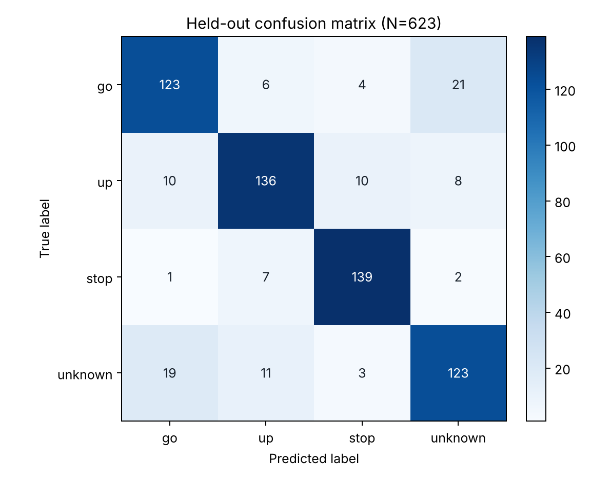
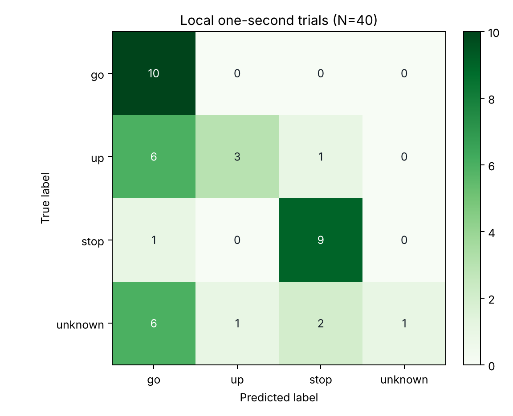
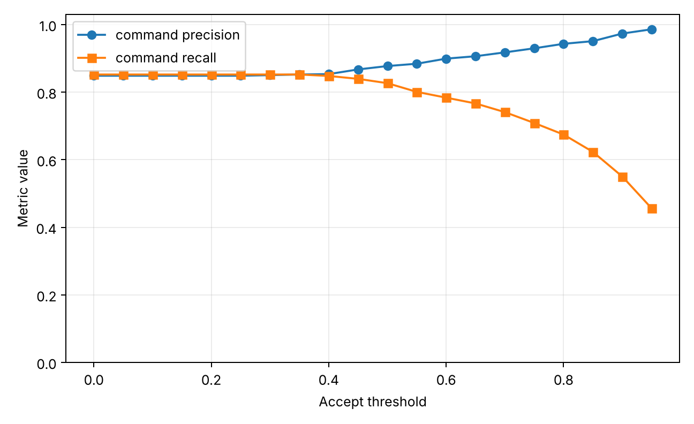

# A2 submission: Voice-controlled timer

## System summary

This is the A1 countdown timer, controlled by voice instead of the light sensor. It runs on a XIAO
ESP32-S3 Sense and uses the onboard PDM microphone, which fills a one-second, 16 kHz window. A new
window starts every 250 ms. For each window, the keyword model (`ece116-keyword-commands` 1.0.0)
outputs four softmax scores in the order `go`, `up`, `stop`, `unknown`.

The scores on their own aren't commands. The policy in `command_policy.cpp` decides when a score
vector counts as one. It accepts a target label when that label is the argmax and its score is at
least 0.90. Then it latches so the same word can't fire twice. It rearms once all three target
scores are below 0.55 and at least 1000 ms have passed, or after 1500 ms regardless.

Accepted commands go into the A1 timer as events it already understands:

- `UP` → `TAP` (adds 10 s)
- `GO` → `COMMIT` (starts the countdown)
- `STOP` → `CANCEL` (clears back to `STANDBY`)

The A1 timer logic itself is unchanged. It still goes `STANDBY` → `ADDING` → `COUNTDOWN` → `DONE`
and adds 10 s per tap. It blinks all the LEDs for 2 s in `DONE`, then returns to `STANDBY` on its
own. The one configuration difference is that `Challenge_2.ino` sets `entryTapsRequired` to 1, so
a single `up` is enough to enter `ADDING`.

## Model artifact

| Field | Value |
|---|---|
| Repository | <https://github.com/ejaywang/ece116-tinyml-models> |
| Artifact ID | `ece116-keyword-commands` |
| Release tag | `keyword-commands-v1.0.0` (commit `e776497`) |
| Release asset | `ece116-keyword-arduino-v1.0.0.zip` |
| Model version | 1.0.0 (`artifact.json`, `MODEL_CARD.md`) |
| Library version | 1.0.0 (`library.properties`, library name `ECE116 A2 Keyword`) |
| Sample rate | 16 kHz (`EI_CLASSIFIER_FREQUENCY 16000`) |
| One-second input | 16,000 signed 16-bit mono PCM samples (`EI_CLASSIFIER_RAW_SAMPLE_COUNT 16000`) |
| Capture stride | 250 ms between the starts of consecutive windows (`capture_stride_ms` in `artifact.json`) |
| Label order | `go`, `up`, `stop`, `unknown` |
| Target | XIAO ESP32-S3 Sense, Espressif `esp32` core 3.3.10, OPI PSRAM |

I copied the six source files, unchanged, into `src/ECE116_A2_Keyword/` in both `Arduino/Lab_2_1/`
and `Arduino/Challenge_2/`. Every copy matches its SHA-256 hash in the release's `artifact.json`.

### File roles

| Role | File | Contents |
|---|---|---|
| Release record | `artifact.json` | Artifact ID, version, tag, target board, input/output contract, and a SHA-256 hash for every file. Not compiled. |
| Metadata | `model_metadata.h` | The shape contract the sketch compiles against: 16 kHz sample rate, 16,000 raw samples per input, 512 network inputs, and 4 labels. No learned values. |
| Parameters | `model_params.h` | The learned weights and biases: `KW_W1` (512 × 64), `KW_B1` (64), `KW_W2` (64 × 4), and `KW_B2` (4). Also the fixed preprocessing constants: Hann window, 32-band mel filterbank, and per-feature normalization mean and standard deviation. |
| Model interface | `ece116_keyword.h` | What the sketch calls: `signal_t`, `ei_impulse_result_t`, the error codes, `pcm16_signal_from_buffer()`, and `run_classifier()`. |
| Model implementation | `ece116_keyword.cpp` | The code behind the interface. It turns 16,000 samples into 512 features (pre-emphasis, 512-sample Hann frames with a 256-sample hop, FFT, 32 log-mel bands pooled into 16 time bins, normalization), then runs a 512 → 64 ReLU → 4 softmax network. |
| Audio interface | `ece116_audio.h` | The `ECE116Audio` class: `begin()`, `copyLatestWindow()`, and `lastError()`. |
| Audio implementation | `ece116_audio.cpp` | Starts the PDM microphone (clock GPIO42, data GPIO41) at 16 kHz and runs a background capture task. Keeps a one-second ring buffer in PSRAM and publishes a new window, with its RMS level and capture time, after every 4,000-sample (250 ms) block. |

Put simply, the metadata tells the sketch how big the input and output are, and the parameters
decide what the model predicts. You could swap in a `model_params.h` with differently trained
weights. The scores would change, but nothing the sketch depends on would.

### Model calls

`pcm16_signal_from_buffer(trialAudioWindow, EI_CLASSIFIER_RAW_SAMPLE_COUNT, &signal)` gets the
recorded audio ready for the model. It doesn't run the model, and it doesn't copy the samples. It
stores the buffer pointer and length, computes the window's mean (the DC offset), and sets up a
read callback in `signal`. When the model reads through that callback, each 16-bit sample comes
back as a float with the mean removed, scaled by 1/32768 into [-1, 1). It returns 0 on success and
-1 if the buffer or signal is null.

`run_classifier(&signal, &result, false)` actually runs inference. If the input isn't 16,000
samples, it returns `EI_IMPULSE_ERROR_SHAPES_DONT_MATCH`. Otherwise it does three things:

1. Reads the samples through the callback.
2. Computes the 512 features and runs the network.
3. Writes the results. The four softmax scores go into `result.classification[]` in `go`, `up`,
   `stop`, `unknown` order. The feature-extraction and classifier times, in ms, go into
   `result.timing.dsp` and `result.timing.classification`.

The `debug` argument is ignored.

What comes out is a score vector, not a command. The four scores add up to about 1, so they're
relative evidence between the four classes. Turning score vectors into timer events is the
Challenge policy's job.

## Understanding one example

Trial 4 from the L4 trials:

```text
TRIAL_RESULT trial_id=4 true_label=unknown recording_ms=1006 rms=0.017803 go=0.7901 up=0.0164 stop=0.0986 unknown=0.0949 argmax_index=0 argmax_label=go dsp_ms=293 classifier_ms=5 inference_wall_ms=298
```

| Field | Value |
|---|---|
| True label | `unknown`: the sketch assigned this label before recording, and I said a non-command word |
| Score vector (`go`, `up`, `stop`, `unknown`) | 0.7901, 0.0164, 0.0986, 0.0949 (sum 1.0000) |
| Argmax label | `go` (index 0) |
| Argmax correct? | No. A non-command word was classified as `go`. |
| Input level | RMS 0.0178 over the one-second window |
| Processing | 293 ms feature extraction (`dsp_ms`) + 5 ms classifier = 298 ms wall time |

The true label is what the trial was set up to record. The sketch picks it before recording
starts, so it doesn't depend on anything the model computes. The scores and the argmax are the
model's read on that recording. They're relative evidence across four classes, not a statement of
what was actually said.

That separation is the only reason this error shows up at all. If the model's output were used as
the label, this row would look like a correct `go`, and it would never be counted as an error.
Because evaluation compares the two fields, this trial adds one to the (true `unknown`, predicted
`go`) cell of the confusion matrix. It also shows what's at stake. If the argmax alone were treated
as a command, this non-command word would have started the countdown.

For comparison, trial 3 (true `stop`, `stop` = 0.9726) is a correct, confident prediction.

## Provided benchmark

Each row of `keyword_eval.csv` is one held-out, labeled one-second recording. A row holds the clip
ID, true label, speaker ID, RMS level, and the released model's four scores.

- There are 623 rows with 623 unique clip IDs, from 236 speakers. None of the speakers were used
  for training or validation.
- The class counts are `go` 154, `up` 164, `stop` 149, and `unknown` 156.
- Every score is in [0, 1], and each row's four scores sum to 1 within 2 × 10⁻⁷.

Argmax accuracy is **0.8363** (521 of 623).


*Confusion matrix for the provided benchmark. Each count is one held-out one-second recording,
N = 623. Rows are true labels; columns are argmax predictions.*

| True \ Predicted | go | up | stop | unknown |
|---|---:|---:|---:|---:|
| **go** | 123 | 6 | 4 | 21 |
| **up** | 10 | 136 | 10 | 8 |
| **stop** | 1 | 7 | 139 | 2 |
| **unknown** | 19 | 11 | 3 | 123 |

| Class | Precision | Recall | Specificity | F1 |
|---|---:|---:|---:|---:|
| go | 0.804 | 0.799 | 0.936 | 0.801 |
| up | 0.850 | 0.829 | 0.948 | 0.840 |
| stop | 0.891 | 0.933 | 0.964 | 0.911 |
| unknown | 0.799 | 0.788 | 0.934 | 0.794 |

**Measured confusion:** 19 of the 156 true `unknown` recordings were predicted as `go`. With plain
argmax, each of those would be a false `go`: someone says a non-command word, and the countdown
starts with whatever time was added.

This is the main reason `go` precision is only 0.804. 30 of the 153 `go` predictions are wrong,
and 19 of those 30 came from non-command speech.

The reverse cell matters less. 21 true `go` recordings were predicted as `unknown`. Each of those
is a missed command, and the timer just stays put until the user says it again.

So for this application, false accepts are the worse error. They change the timer when nobody
meant to, while a miss only means repeating the word. That's why the Challenge threshold is set to
limit false accepts. These numbers describe the held-out corpus recordings only.

## Local model validation

| Condition | Value |
|---|---|
| Speaker | One speaker (me) |
| Microphone | XIAO ESP32-S3 Sense onboard PDM microphone, `Lab_2_1.ino` |
| Distance | About 25 cm from mouth to board |
| Room | Indoor room with some background noise |
| Session | One continuous session on October 23, 2026, trial IDs 1–40 after a board reset |
| Non-command words | banana, pretzel, watermelon, table, couch, and hello |

The full log is `Documentation/a2_local_trials.txt`. It has 40 valid `TRIAL_RESULT` rows, 10 each
of `go`, `up`, `stop`, and `unknown`. Argmax accuracy on this set is 0.575 (23 of 40).


*Confusion matrix for the local validation set. Each count is one local one-second trial, N = 40.
Rows are true labels; columns are argmax predictions.*

| True \ Predicted | go | up | stop | unknown |
|---|---:|---:|---:|---:|
| **go** | 10 | 0 | 0 | 0 |
| **up** | 6 | 3 | 1 | 0 |
| **stop** | 1 | 0 | 9 | 0 |
| **unknown** | 6 | 1 | 2 | 1 |

**Valid trials whose argmax differs from the true label (17):**

| Trial | True | Argmax | Top score | RMS |
|---:|---|---|---:|---:|
| 2 | up | go | 0.6853 | 0.1281 |
| 4 | unknown | go | 0.9425 | 0.0098 |
| 6 | up | go | 0.5286 | 0.0011 |
| 8 | unknown | stop | 0.3770 | 0.0088 |
| 10 | up | go | 0.4103 | 0.0176 |
| 12 | unknown | go | 0.3903 | 0.0125 |
| 14 | up | go | 0.3736 | 0.0163 |
| 15 | stop | go | 0.4119 | 0.0107 |
| 16 | unknown | go | 0.4689 | 0.0057 |
| 20 | unknown | go | 0.9856 | 0.0247 |
| 24 | unknown | stop | 0.8681 | 0.0109 |
| 26 | up | stop | 0.3921 | 0.0113 |
| 30 | up | go | 0.3465 | 0.0143 |
| 32 | unknown | go | 0.9087 | 0.0098 |
| 34 | up | go | 0.4389 | 0.0170 |
| 36 | unknown | go | 0.7320 | 0.0108 |
| 40 | unknown | up | 0.4445 | 0.0065 |

**Malformed or aborted attempts:** none. Every button press gave one complete `TRIAL_RESULT`. The
`TRIAL_ARMED` line for trial 8 is missing from the log I copied. Its `RECORDING_START` and
`TRIAL_RESULT` lines are complete, though, so the row is still valid. Trial 6 has a very low RMS
(0.0011), which probably means the word mostly fell outside the recording window. It's still a
complete trial, so I kept it.

**Comparison with the benchmark:** the clearest local pattern is that the model over-predicts
`go`.

- All 10 of my `go` trials were right, but 13 of the other 30 trials were also called `go`: 6 of
  10 `up`, 6 of 10 `unknown`, and 1 of 10 `stop`.
- On the benchmark, those same cells are only 10 of 164 `up` and 19 of 156 `unknown`.
- `stop` behaved about the same in both: 9 of 10 locally, 139 of 149 on the benchmark.

This is one speaker, one room, one distance, and one session, so it doesn't estimate general
accuracy. With 10 trials per class, a single trial also moves a class rate by 10 percentage
points. What it does show is that, under my conditions, the model calls far more non-`go` speech
`go` than the held-out corpus would suggest.

## Operating policy

**Requirement (supplied):** of the benchmark windows accepted as `GO`, `UP`, or `STOP`, at least
97% must have the correct target label.

| Value | Setting | Source |
|---|---|---|
| Accept threshold | 0.90 | Lowest tested threshold that meets the requirement (`Challenge_2_Policy.ipynb`) |
| Release threshold | 0.55 | Supplied |
| Minimum latch time | 1000 ms | Supplied; one full input-window duration |
| Maximum latch time | 1500 ms | Supplied fail-safe |

The same four values are set in `makeCommandPolicyConfig()` in
`Arduino/Challenge_2/command_policy.cpp`, and `Challenge_2.ino` prints them at boot.

**Acceptance:** while the policy is armed, a window only becomes a command if its argmax is `go`,
`up`, or `stop` and that score is at least 0.90. `unknown` never produces an event. Once a command
is accepted, the policy latches and saves the event time.

**Exact rearm rules:** while latched, every window returns `NONE`. With `elapsed = now −
latchTime` in unsigned 32-bit arithmetic, the policy rearms on a window when:

```text
normal release  = (go < 0.55 AND up < 0.55 AND stop < 0.55) AND elapsed >= 1000 ms
maximum timeout = elapsed >= 1500 ms
rearm           = normal release OR maximum timeout
```

The rearming window doesn't emit anything itself, so the earliest a new event can happen is the
next window.

**Normal release** is how the policy knows the word is over. All three target scores have dropped,
and at least one full one-second window has passed, so none of the triggering audio can still be
in the model's input. Using scores alone could rearm during a brief dip in the middle of the same
word. Using time alone could rearm while the word is still in the window. Requiring both prevents
either kind of double trigger.

**The maximum latch is a fail-safe.** A timeout doesn't mean the word ended. It only means 1500 ms
passed while some target score stayed at or above 0.55, for example from a stuck score, steady
noise, or a long word. Without the timeout, one stuck high score would block every later command
forever.

The downside is that after a timeout, a score still at or above 0.90 can be accepted again on the
next window. So a stuck score could repeat an event about every 1.75 s. A repeat the user can see
and fix, by saying `stop` for example, is better than a timer that stops listening.

**Precision/recall tradeoff:** at 0.90, the benchmark accepts 264 windows, and 257 are correct.
That's a command precision of **0.973** and a command recall of **0.550**, with 7 false accepts.

- The next lower tested threshold, 0.85, only reaches 0.951 precision.
- A higher tested threshold, 0.95, gives 0.986 precision but drops recall to 0.456.

Raising the threshold rejects more real commands, so the user has to repeat themselves more.
Lowering it lets more false commands through. A false command adds 10 seconds, starts the
countdown, or clears the timer when nobody asked. That's why the requirement is on precision, and
why picking the lowest threshold that meets it keeps as much recall as possible.


*Command precision and recall on the 623-example benchmark versus accept threshold. 0.90 is the
lowest tested threshold with precision ≥ 0.97.*

As a local check only, applying 0.90 to my 40 local trials accepts 19, and 16 of those are correct
(precision 0.842, recall 0.533). The 3 false accepts are `unknown` trials 4, 20, and 32, all
accepted as `go`. So under my conditions, the benchmark operating point doesn't reach 97%
precision. It's one session and one speaker, but it matches the `go` over-prediction above.

## Sequential replay

Replay of `score_traces.csv` at accept 0.90, release 0.55, minimum latch 1000 ms, and maximum latch
1500 ms (`Challenge_2_Policy.ipynb`):

| Trace | Expected | Observed | Pass |
|---|---|---|---|
| `single_go` | 1 × go | go | pass |
| `single_up` | 1 × up | up | pass |
| `single_stop` | 1 × stop | stop | pass|
| `unknown_word` | 0 events | none | pass |
| `two_go` | 2 × go | go, go | pass |
| `class_shift_one_utterance` | 1 × go | go | pass |
| `maximum_latch_recovery` | 2 × go | go, go | pass |

**`class_shift_one_utterance`:**

- **0 ms:** `go` 0.95 is accepted. The policy goes from armed to latched and emits `go`.
- **250–750 ms:** the strongest class changes three times while latched, and each window is
  suppressed: `up` 0.74 at 250 ms, `stop` 0.92 at 500 ms, and `up` 0.90 at 750 ms. Without the
  latch, the 500 ms and 750 ms windows would have been extra `stop` and `up` events.
- **1000 ms:** the scores are `go` 0.10, `up` 0.12, `stop` 0.08, `unknown` 0.70. Every target is
  below 0.55 and 1000 ms have passed, so normal release rearms the policy. That window doesn't emit
  anything.

**`maximum_latch_recovery`:** `go` stays at 0.95 the whole time, so normal release never happens.

- **250–1250 ms:** every window is suppressed.
- **1500 ms:** `elapsed = 1500 ≥ 1500`, so the timeout rearms the policy without an event.
- **1750 ms:** the next `go` is accepted.

That repeat is the price of never getting stuck permanently.

**C++ equivalence:** `updateCommandPolicy()` makes the same decisions, in the same order, as the
notebook's `trace_policy()`:

- **Acceptance:** when `commandIsLatched` is false, it only accepts an argmax index of 0–2 with a
  score of at least `acceptThreshold`. Then it sets `commandIsLatched = true` and
  `commandLatchedMs = nowMs`, and returns the matching event.
- **Suppression:** while latched, it always returns `COMMAND_EVENT_NONE`.
- **Normal release:** it loops over the three target scores to get
  `everyTargetCommandScoreIsBelowReleaseThreshold`. `normalReleaseIsReady` is that value AND
  `commandHasBeenLatchedForMs >= minimumLatchMs`.
- **Timeout:** `maximumLatchTimeHasElapsed` is `commandHasBeenLatchedForMs >= maximumLatchMs`.
- **Rearming:** if either one is true, it clears `commandIsLatched`, and that window still returns
  `NONE`.
- **Rollover:** `commandHasBeenLatchedForMs = nowMs - commandLatchedMs` is unsigned 32-bit
  subtraction, so elapsed time stays correct when `millis()` wraps around.

Both student traces below were also run through the compiled C++ policy twice: once starting at
time 0, and once starting 601 ms before `millis()` wraps past 2³². All four runs gave the same
events as the notebook (`up stop` and `go up`).

### `student_normal_release`

| time_ms | go | up | stop | unknown | Before | Event | After | Reason |
|---:|---:|---:|---:|---:|---|---|---|---|
| 0 | 0.02 | 0.93 | 0.02 | 0.03 | ARMED | up | LATCHED | accepted target |
| 250 | 0.01 | 0.96 | 0.01 | 0.02 | LATCHED | none | LATCHED | suppressed |
| 500 | 0.05 | 0.08 | 0.05 | 0.82 | LATCHED | none | LATCHED | quiet, but only 500 ms elapsed |
| 750 | 0.03 | 0.04 | 0.91 | 0.02 | LATCHED | none | LATCHED | class shift suppressed |
| 1000 | 0.03 | 0.05 | 0.62 | 0.30 | LATCHED | none | LATCHED | 1000 ms elapsed, but `stop` ≥ 0.55 |
| 1250 | 0.04 | 0.05 | 0.06 | 0.85 | LATCHED | none | ARMED | normal release |
| 1500 | 0.01 | 0.02 | 0.95 | 0.02 | ARMED | stop | LATCHED | accepted target |

Predicted `['up', 'stop']`; observed `['up', 'stop']`.

This trace catches a policy that rearms on quiet scores alone, without the minimum latch. That
policy would rearm at 500 ms, accept `stop` 0.91 at 750 ms, and give `['up', 'stop', 'stop']`. It
also catches a policy with no latch at all, which would fire again at 250 ms and 750 ms.

### `student_maximum_latch`

| time_ms | go | up | stop | unknown | Before | Event | After | Reason |
|---:|---:|---:|---:|---:|---|---|---|---|
| 0 | 0.96 | 0.01 | 0.01 | 0.02 | ARMED | go | LATCHED | accepted target |
| 250 | 0.95 | 0.01 | 0.01 | 0.03 | LATCHED | none | LATCHED | suppressed |
| 500 | 0.95 | 0.01 | 0.01 | 0.03 | LATCHED | none | LATCHED | suppressed |
| 750 | 0.94 | 0.02 | 0.01 | 0.03 | LATCHED | none | LATCHED | suppressed |
| 1000 | 0.94 | 0.02 | 0.01 | 0.03 | LATCHED | none | LATCHED | minimum met, `go` ≥ 0.55 |
| 1250 | 0.93 | 0.02 | 0.02 | 0.03 | LATCHED | none | LATCHED | suppressed |
| 1499 | 0.93 | 0.02 | 0.02 | 0.03 | LATCHED | none | LATCHED | 1 ms before maximum latch |
| 1500 | 0.93 | 0.02 | 0.02 | 0.03 | LATCHED | none | ARMED | maximum-latch recovery |
| 1750 | 0.02 | 0.95 | 0.01 | 0.02 | ARMED | up | LATCHED | accepted target |

Predicted `['go', 'up']`; observed `['go', 'up']`.

This trace catches three wrong policies:

- **No timeout:** it stays latched on the stuck `go` and misses the `up` at 1750 ms (`['go']`).
- **A timeout window that emits an event:** it fires `go` again at 1500 ms (`['go', 'go', 'up']`).
- **Rearming on minimum time alone:** it rearms at 1000 ms and accepts `go` again at 1250 ms.

### `check_command_policy.py` output

```text
PASS policy values
PASS class-to-event mapping
PASS sub-threshold rejection
PASS accepted command
PASS class-shift suppression
PASS minimum latch time
PASS quiet release window
PASS later utterance after release
PASS maximum latch not early
PASS maximum latch timeout window
PASS later utterance after timeout
Public command-policy checks: 11/11
```

The two rearm checks line up with rows in the student traces. "quiet release window" is the normal
release at 1250 ms in `student_normal_release`. "maximum latch timeout window" is the 1500 ms
timeout in `student_maximum_latch`.

## Integrated system

| Setting | Value |
|---|---|
| Board | Seeed Studio XIAO ESP32-S3 Sense (`XIAO_ESP32S3`), onboard PDM microphone |
| Core and IDE | `esp32` by Espressif Systems 3.3.10, Arduino IDE 2.3.10 |
| PSRAM | OPI PSRAM (needed for the audio buffers; see **Build and reproduction**) |
| USB CDC On Boot | Enabled, Serial Monitor at 115200 baud |
| LEDs | Green D1/GPIO2 = `STANDBY`, amber D2/GPIO3 = `ADDING`, red D3/GPIO4 = `COUNTDOWN`; all three blink every 200 ms in `DONE` |
| Command-to-A1 adapter | `a1TimerEventForCommand()`: `UP` → `COVER_EVENT_TAP`, `GO` → `COVER_EVENT_COMMIT`, `STOP` → `COVER_EVENT_CANCEL` |
| A1 timer | `makeTimerConfig()` unchanged (800 ms tap window, 10 s per tap, 2000 ms `DONE`); `Challenge_2.ino` sets `entryTapsRequired = 1` |
| Policy | accept 0.90, release 0.55, minimum latch 1000 ms, maximum latch 1500 ms (printed at every boot) |

**Test conditions:** just me speaking, about 25 cm from the board, on October 23, 2026. I used the
same indoor room as the local validation, with some background noise. Every run starts from a board
reset.

All the runs are in `Documentation/a2_c5_serial_log.txt`, labeled Run A to Run D. When reading it,
note that the sketch updates the timer first and prints the scores after. So for an accepted
window, the `event=` and `status_ms=` lines appear just before that window's `SCORES` row.

**Replay check:** every `SCORES` row in Runs A–D was replayed through the rearm rules from
**Operating policy**, using `captured_ms` as the time. The replay gives exactly the logged events:
25 accepted events across 626 windows, with no mismatches.

### Run A: required C5 sequence

| Step | Spoken | Accepted window (`window`, `captured_ms`, score) | Timer output | Result |
|---|---|---|---|---|
| 1 | (boot) | | `status_ms=18 mode=STANDBY`; green on | Pass |
| 2 | `up`, `up` | 41, 17539, up 0.9317; 51, 20794, up 0.9484 | `ADDING seconds=10`, then `ADDING seconds=20`; amber on | Pass |
| 3 | `go` | 62, 24034, go 0.9444 | `COUNTDOWN seconds=20`, then 19, 18 … 9; red on | Pass |
| 4 | Sentence with no command word | None from window 63 to 100 | Countdown kept going with no transition | Pass |
| 5 | `stop` | 101, 36034, stop 0.9127 | `status_ms=36516 mode=STANDBY`; green on | Pass |
| 6 | `up`, `go`, then wait | 111, 39034, up 0.9915; 122, 42544, go 0.9319 | `COUNTDOWN seconds=10` … 1, `status_ms=53119 mode=DONE`, `status_ms=55270 mode=STANDBY` (2151 ms later) | Pass |
| 7 | `up`, then `up` again after rearm | 214, 70789, up 0.9956; 229, 75544, up 0.9590 | `ADDING seconds=10`, then `ADDING seconds=20` | Pass |

A few details from Run A:

- **Step 3:** window 63 (go 0.9657) was still above the accept threshold, but the latch suppressed
  it.
- **Step 6:** all three LEDs blinked in `DONE`, then the board went back to `STANDBY` on its own.
- **Step 7:** the latch from window 214 rearmed through normal release at window 217 (1005 ms), so
  the second `up` registered.
- **End of the run:** I also said `stop` (window 237) and one more `up` (window 265).

### Run B: five attempts per target command

Five `up` → `go` → `stop` cycles. Each cell shows the accepted window, its `captured_ms`, the
accepted score, and the timer line it produced.

| Cycle | `up` | `go` | `stop` |
|---|---|---|---|
| 1 | 13, 4534, 0.9736 → `ADDING 10` | 27, 8794, 0.9478 → `COUNTDOWN 10` | 33, 10789, 0.9985 → `STANDBY` |
| 2 | 41, 13294, 0.9825 → `ADDING 10` | 56, 17794, 0.9860 → `COUNTDOWN 10` | 62, 19789, 1.0000 → `STANDBY` |
| 3 | 72, 22789, 0.9287 → `ADDING 10` | 78, 24544, 0.9125 → `COUNTDOWN 10` | 86, 27034, 0.9994 → `STANDBY` |
| 4 | 94, 29539, 0.9371 → `ADDING 10` | 101, 31534, 0.9604 → `COUNTDOWN 10` | 107, 33544, 1.0000 → `STANDBY` |
| 5 | 114, 35539, 0.9947 → `ADDING 10` | 119, 37294, 0.9894 → `COUNTDOWN 10` | 125, 39034, 0.9937 → `STANDBY` |

All 15 attempts triggered the right event exactly once. The LEDs matched the logged mode every
time: amber after `up`, red after `go`, and green after `stop`.

In twelve other Run B windows, a target scored 0.90 or higher while the policy was latched, and
every one returned `NONE`. In cycle 4, for example, `up` stayed above 0.90 for windows 94, 95, and
96, and still produced only one event.

Of the 15 rearms, 10 were normal releases and 5 were maximum-latch timeouts (windows 67, 77, 83,
99, and 106). The timeouts happened because the room's background `go` score stayed at or above
0.55 after I finished each word.

The cycle 4 `stop` shows the timeout path well. Window 106 scored stop 0.9985, but it was also the
window that timed out the latch from the `go` at window 101 (1755 ms), so it didn't emit anything.
The next window, 107, accepted `STOP` about 255 ms later.

### Run D: 10 non-command phrases

In `STANDBY`, a few seconds apart, I said "hello there", "what time is it", "good morning", "turn on
the lights", "thank you very much", "I like music", "where is the library", "banana bread", "seven
eight nine", and "see you later".

All 184 windows (`captured_ms` 1038–57034) returned `event=NONE`. The mode stayed `STANDBY` the
whole time, with the green LED on. No target score reached 0.90. The closest were:

- up 0.8996 (window 33, `captured_ms=10789`), only 0.0004 below the threshold
- go 0.8896 (window 147)
- go 0.8865 (window 59)
- stop 0.7737 (window 156)

Run C is just a board reset with no speech (8 windows, no events).

### Attempt summary (Runs B and D)

| Intended | Attempts | Correct | Missed | Wrong | Repeated | False |
|---|---:|---:|---:|---:|---:|---:|
| `up` | 5 | 5 | 0 | 0 | 0 | 0 |
| `go` | 5 | 5 | 0 | 0 | 0 | 0 |
| `stop` | 5 | 5 | 0 | 0 | 0 | 0 |
| Non-command speech | 10 | 10 (no event) | – | – | – | 0 |

None of the attempts in the structured runs failed.

Before these runs, I also tested the system more casually, without writing down what I said
(`Documentation/a2_c5_bringup_log.txt`, 14 boots). In those boots, the policy accepted 14 `GO` and
7 `STOP` events while the timer was in `STANDBY`. Most of them came during long idle stretches
(boots 11 and 14), and in boot 11 they came after the part shown in the video.

A1 ignores `COMMIT` and `CANCEL` in `STANDBY`, so none of these events changed the timer. I didn't
count them above, because I don't know what was said at those moments. If no command was spoken,
though, each one is a false policy event (see **Limitations**).

### Representative Serial excerpt (Run B, cycle 4)

```text
SCORES window=93 captured_ms=29284 rms=0.019505 go=0.3026 up=0.6416 stop=0.0177 unknown=0.0382 event=NONE mode=STANDBY dsp_ms=293 cls_ms=5
event=UP
status_ms=29930 mode=ADDING seconds=10
SCORES window=94 captured_ms=29539 rms=0.019760 go=0.0192 up=0.9371 stop=0.0425 unknown=0.0012 event=UP mode=ADDING dsp_ms=293 cls_ms=5
SCORES window=95 captured_ms=29794 rms=0.018108 go=0.0017 up=0.9117 stop=0.0799 unknown=0.0066 event=NONE mode=ADDING dsp_ms=293 cls_ms=5
SCORES window=96 captured_ms=30034 rms=0.013692 go=0.0110 up=0.9784 stop=0.0025 unknown=0.0082 event=NONE mode=ADDING dsp_ms=296 cls_ms=5
SCORES window=97 captured_ms=30544 rms=0.026481 go=0.7142 up=0.0948 stop=0.1376 unknown=0.0533 event=NONE mode=ADDING dsp_ms=293 cls_ms=5
SCORES window=98 captured_ms=30784 rms=0.025101 go=0.7550 up=0.0446 stop=0.1402 unknown=0.0602 event=NONE mode=ADDING dsp_ms=293 cls_ms=5
SCORES window=99 captured_ms=31039 rms=0.028881 go=0.8119 up=0.0341 stop=0.1003 unknown=0.0537 event=NONE mode=ADDING dsp_ms=293 cls_ms=5
SCORES window=100 captured_ms=31294 rms=0.031102 go=0.7097 up=0.0281 stop=0.0593 unknown=0.2029 event=NONE mode=ADDING dsp_ms=293 cls_ms=5
event=GO
status_ms=32083 mode=COUNTDOWN seconds=10
SCORES window=101 captured_ms=31534 rms=0.019486 go=0.9604 up=0.0033 stop=0.0044 unknown=0.0319 event=GO mode=COUNTDOWN dsp_ms=294 cls_ms=5
SCORES window=102 captured_ms=32044 rms=0.012573 go=0.8450 up=0.0059 stop=0.0078 unknown=0.1413 event=NONE mode=COUNTDOWN dsp_ms=293 cls_ms=5
SCORES window=103 captured_ms=32284 rms=0.012157 go=0.1874 up=0.6013 stop=0.0776 unknown=0.1338 event=NONE mode=COUNTDOWN dsp_ms=293 cls_ms=5
SCORES window=104 captured_ms=32539 rms=0.008318 go=0.6152 up=0.1114 stop=0.1854 unknown=0.0880 event=NONE mode=COUNTDOWN dsp_ms=293 cls_ms=5
SCORES window=105 captured_ms=32794 rms=0.007731 go=0.5938 up=0.0740 stop=0.2139 unknown=0.1182 event=NONE mode=COUNTDOWN dsp_ms=297 cls_ms=5
status_ms=33313 mode=COUNTDOWN seconds=9
SCORES window=106 captured_ms=33289 rms=0.012135 go=0.0003 up=0.0011 stop=0.9985 unknown=0.0002 event=NONE mode=COUNTDOWN dsp_ms=293 cls_ms=5
event=STOP
status_ms=33926 mode=STANDBY
SCORES window=107 captured_ms=33544 rms=0.012179 go=0.0000 up=0.0000 stop=1.0000 unknown=0.0000 event=STOP mode=STANDBY dsp_ms=293 cls_ms=5
```

What happens in the excerpt:

- **Window 94** accepts `UP`.
- **Windows 95 and 96** still score `up` above 0.90, but the latch suppresses them.
- **Window 99** rearms by timeout at 1500 ms. Normal release can't happen, because background `go`
  stays above 0.55.
- **Window 101** accepts `GO`. The countdown starts at 10 and drops to 9.
- **Window 106** times out the `GO` latch. It scores stop 0.9985 but emits nothing, because it's
  the rearming window.
- **Window 107** accepts `STOP`.

### Demonstration video

[`Fig/voice_timer_demo.mp4`](Fig/voice_timer_demo.mp4) shows the LEDs and the Serial Monitor at the
same time, over 51 s. It covers the full C5 sequence:

1. `up`, then `up` again;
2. `go`, then a non-command sentence during the countdown;
3. `stop`;
4. `up`, then `go`, through `DONE` and back to `STANDBY`;
5. `up`, then `stop`.

The video is the run logged as boot 11 in `Documentation/a2_c5_bringup_log.txt`. Its LED changes
line up with that boot's `status_ms` lines to within 0.04 s. For example, the `DONE` blinking lasts
2.15 s on the video, and 2.15 s in the log.

## Timing

| Quantity | Value | Kind and source |
|---|---|---|
| Input window | 1000 ms (16,000 samples at 16 kHz) | Configured: `EI_CLASSIFIER_RAW_SAMPLE_COUNT`, `kSampleCount` in `ece116_audio.h` |
| Capture stride | 250 ms between the starts of consecutive windows (4,000-sample blocks) | Configured: `capture_stride_ms` in `artifact.json`, `kBlockSamples` in `ece116_audio.h` |
| DSP (feature extraction) | 293–297 ms per window | Model-reported `dsp_ms` (`result.timing.dsp`), every window in Runs A–D |
| Classifier | 5–6 ms per window | Model-reported `cls_ms` (`result.timing.classification`), same windows |
| Spacing of processed windows | 240–257 ms, with a 495–510 ms gap about once every five windows | From the log: differences between consecutive `captured_ms` values |
| Window complete → timer update | 307–549 ms (median 424 ms) over the 15 Run B events | From the log: `status_ms − captured_ms` for each accepted window |
| Displayed-second updates | Every 919–1232 ms during countdown | From the log: consecutive `status_ms` countdown lines |
| Command onset → first LED change | About 1.0 s (median 1.02 s, range 0.84–1.19 s, 7 commands) | Physical observation on `Fig/voice_timer_demo.mp4` |

These values measure different things:

- **Configured values** describe the input. Each window is the last 1000 ms of audio, and a new
  one is ready every 250 ms. `captured_ms` is recorded when the window's last block arrives, so it
  marks the end of the window.
- **Model-reported times** are computation only. DSP plus the classifier takes about 300 ms per
  window, which is longer than the 250 ms stride. So the loop always grabs the newest window and
  skips about one in six. That's where the ~500 ms gaps in `captured_ms` come from.
- **Timer updates** only happen between inferences. That's why an accepted window reaches the timer
  307–549 ms after it was captured. It's also why the displayed seconds change every 0.9–1.2 s
  instead of exactly once a second.
- **None of these is the delay a person notices.** That delay also includes the time it takes for
  enough of the word to get into a window to push its score past 0.90.

**Physical latency:** measured on the video timeline (59.94 fps, about 17 ms per frame), from the
audible start of each command in the video's soundtrack to the first frame where the matching LED
changes. This is an observed end-to-end delay, not model execution time.

| Command | Word starts (s) | LED changes (s) | Latency (s) |
|---|---:|---:|---:|
| `up` | 0.95 | 1.82 (green → amber) | 0.87 |
| `go` | 6.60 | 7.69 (amber → red) | 1.09 |
| `stop` | 17.72 | 18.74 (red → green) | 1.02 |
| `up` | 21.11 | 22.12 (green → amber) | 1.01 |
| `go` | 24.34 | 25.53 (amber → red) | 1.19 |
| `up` | 39.09 | 40.26 (green → amber) | 1.17 |
| `stop` | 46.19 | 47.03 (amber → green) | 0.84 |

The second `up` at 3.9 s isn't included, because it only takes `ADDING` from 10 to 20 s and
doesn't change an LED.

Of the roughly 1 s delay, about 0.3–0.55 s is the time from the end of the accepted window to the
timer update (from the Serial log). The rest is the time for enough of the word to get into a
window to push its score past 0.90.

## Limitations

**Speakers and conditions.** Everything I tested, locally and on the full system, was one speaker
(me) at about 25 cm, in one indoor room, on one evening. That's very different from the benchmark's
236 speakers. None of my results say anything about:

- other speakers or accents;
- distances beyond about 25 cm;
- louder or different noise, such as music, a TV, or several people talking;
- the board inside an enclosure.

On my local set, the 0.90 threshold only got 0.842 precision, compared with 0.973 on the
benchmark.

**Long idle periods and normal conversation.** My system tests only cover 10 short non-command
phrases (no false events) and short command cycles. They don't show how often false events happen
over minutes or hours, and a few things suggest the margin is thin:

- In Run D, one non-command phrase pushed `up` to 0.8996, only 0.0004 under the threshold.
- In a quiet room, `go` sits around 0.46–0.58 (median of the low-RMS windows in Runs D and B).
  That's why 5 of the 15 Run B rearms needed the timeout.
- In the bring-up boots, the policy accepted 14 `GO` and 7 `STOP` events in `STANDBY`. The timer
  ignored them. But a false `UP` in `STANDBY` would start `ADDING`, and a false `GO` in `ADDING`
  would start a countdown nobody asked for.

I also didn't test words that contain command sounds, like "upload", "going", "stopwatch", or "no".

The latency figure comes from one video with 7 commands, so it's an approximate value for these
conditions, not a general one.

**Next test:** leave the board in `STANDBY` for 30 minutes, at the usual distance, with normal
conversation and a TV playing.

1. Record the room audio at the same time, so each logged event can be matched to what was said
   using `captured_ms`.
2. Count false events per hour for each label.
3. Replay the logged scores at 0.90 and 0.95.

That would show the real false-event rate, and whether raising the threshold to 0.95 is worth the
recall it costs. Neither the benchmark nor 10 phrases can answer that.

## Build and reproduction

### Model release

1. Download `ece116-keyword-arduino-v1.0.0.zip` from the fixed `keyword-commands-v1.0.0` release:
   <https://github.com/ejaywang/ece116-tinyml-models/releases/download/keyword-commands-v1.0.0/ece116-keyword-arduino-v1.0.0.zip>.
   Don't use a later release.
2. Extract the ZIP somewhere outside the A2 package.
3. Copy the six files from the extracted `arduino/ECE116_A2_Keyword/src/` folder, unchanged, into
   both sketch folders:
   - `Arduino/Lab_2_1/src/ECE116_A2_Keyword/`
   - `Arduino/Challenge_2/src/ECE116_A2_Keyword/`

   The files are `ece116_audio.cpp`, `ece116_audio.h`, `ece116_keyword.cpp`, `ece116_keyword.h`,
   `model_metadata.h`, and `model_params.h`. The model isn't installed as a global Arduino
   library, so each sketch carries its own copy.
4. Check each copy against its SHA-256 hash in the release's `artifact.json`. All 12 copies match.

### Arduino build

| Setting | Value |
|---|---|
| Board package | `esp32` by Espressif Systems, version 3.3.10 |
| Board | `XIAO_ESP32S3` (Seeed Studio XIAO ESP32-S3 Sense) |
| PSRAM | Tools > PSRAM > OPI PSRAM |
| Serial Monitor | 115200 baud |
| Upload port | The board's USB modem port (`/dev/cu.usbmodem1101` on my Mac) |

Open the sketch folder in Arduino IDE, use the settings above, and click Verify. `Lab_2_1.ino`
compiled with the model source in place: "Sketch uses 322457 bytes (9%) of program storage space"
and "Global variables use 22340 bytes (6%) of dynamic memory."

If the port doesn't show up or the upload can't connect:

1. Close Serial Monitor.
2. Hold `BOOT`, tap `RESET`, then let go of `BOOT`.
3. Pick the new USB modem port and upload again.

If the sketch doesn't start after uploading, tap `RESET`.

### Notebooks and policy self-check

Both notebooks were run top to bottom in local Jupyter, from the package's `Python/` directory
(Python 3.13.17, NumPy 2.5.3, Matplotlib 3.11.2, on Linux). Colab works too: upload the notebook,
then upload the full package ZIP when the setup cell asks for it.

1. `Lab_2_2_Evaluation.ipynb` reads `keyword_eval.csv` and `../Documentation/a2_local_trials.txt`.
   It writes `Fig/a2_confusion.png` and `Fig/a2_local_confusion.png`.
2. `Challenge_2_Policy.ipynb` reads `keyword_eval.csv`, `score_traces.csv`, and
   `trace_manifest.csv`. It writes `Fig/a2_threshold_sweep.png`.
3. From `Python/`, `python check_command_policy.py` compiles `command_policy.cpp` with the host
   compiler (g++ 13.3.0 here, on Linux, not the Arduino ESP32 compiler) and prints the named checks.

### Challenge sketch and integrated-system run

1. Open `Arduino/Challenge_2/` with the six model files in `src/ECE116_A2_Keyword/`. Use the
   **Arduino build** settings, and make sure OPI PSRAM is selected before compiling. My first build,
   made before I selected it, booted with `FAIL audio setup: PSRAM unavailable`. Rebuilding and
   re-uploading with OPI PSRAM fixed it.
2. Verify and upload `Challenge_2.ino`. Every run in `a2_c5_serial_log.txt` starts with its boot
   banner and the policy line `policy accept=0.90 release=0.55 minimum_latch_ms=1000
   maximum_latch_ms=1500`.
3. Wire the LEDs as listed in **Integrated system**. Open Serial Monitor at 115200 baud and tap
   `RESET`. The board boots to `STANDBY` with the green LED on.
4. Speak from about 25 cm and do three runs, copying the Serial Monitor output into the log after
   each one:
   - the C5 sequence (Run A);
   - five `up` → `go` → `stop` cycles (Run B);
   - the 10 non-command phrases in `STANDBY` (Run D).
5. To check the policy against the log, replay each run's `SCORES` rows through the rules in
   **Operating policy**, with `captured_ms` as the time. The events should match the `event=`
   field.
6. To measure physical latency, record the LEDs with a phone video that includes sound. Then, for
   each command, compare the start of the word in the soundtrack with the first frame where the
   matching LED changes.

### Submitted files

| Path | Contents |
|---|---|
| `Arduino/Lab_2_1/Lab_2_1.ino` | Lab sketch with the completed model calls |
| `Arduino/Lab_2_1/src/ECE116_A2_Keyword/` | Six fixed-release model files |
| `Arduino/Challenge_2/Challenge_2.ino` | Supplied integration sketch, unchanged |
| `Arduino/Challenge_2/command_policy.cpp` | Completed command policy |
| `Arduino/Challenge_2/command_policy.h`, `a1_timer_logic.cpp`, `a1_timer_logic.h` | Supplied, unchanged |
| `Arduino/Challenge_2/src/ECE116_A2_Keyword/` | The same six model files |
| `Python/Lab_2_2_Evaluation.ipynb` | Executed with saved outputs |
| `Python/Challenge_2_Policy.ipynb` | Executed with saved outputs |
| `Python/check_command_policy.py`, `eval_lib.py`, CSV files | Supplied, unchanged |
| `Documentation/README.md` | This report |
| `Documentation/a2_local_trials.txt` | 40 local one-second trials (Lab) |
| `Documentation/a2_c5_serial_log.txt` | Integrated-system Runs A–D |
| `Documentation/a2_c5_bringup_log.txt` | Unstructured bring-up boots; boot 11 is the run in the video |
| `Documentation/Fig/a2_confusion.png`, `a2_local_confusion.png`, `a2_threshold_sweep.png` | Notebook figures |
| `Documentation/Fig/voice_timer_demo.mp4` | Integrated-system demonstration video (boot 11) |